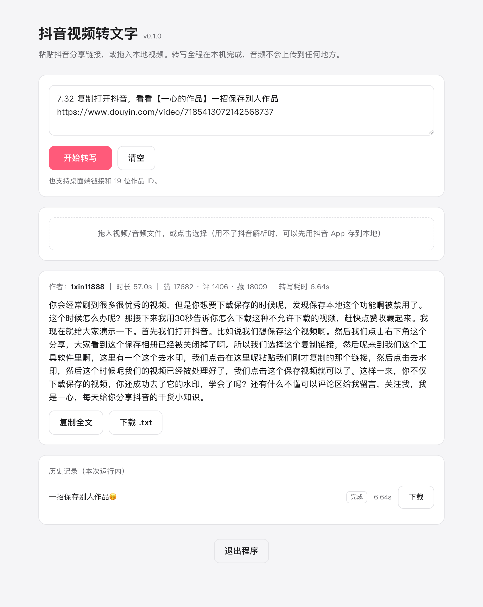

# douyin2text

把抖音视频里的人声拆成文字稿。给一条链接，出一个 `.txt`。

**转写全程在本地离线完成**，不需要 GPU，音频不经过任何第三方服务。
一段 1 分钟的视频，在 M4 Mac 上从链接到文字稿大约 **2–6 秒**（其中转写本身不到 1 秒）。



## 功能

- 粘贴抖音分享文本 / 链接 / 作品 ID，得到带标点的文字稿
- **历史记录持久化**：转写过的内容留在本地，关掉窗口再打开还在，可随时回看、复制、下载、删除
- 一键复制全文，或下载 `.txt`
- 也支持拖入本地视频、音频文件
- 命令行可用，方便批处理和接脚本
- 深色模式自适应

## 为什么这个项目存在

抖音的下载层是唯一真正麻烦的地方。常见的三种做法**目前都已失效**：

| 做法 | 实测结果 |
|---|---|
| `yt-dlp`（自带 Douyin extractor） | ❌ 源码里写着 `TODO: Run verification challenge code to generate signature cookies`，详情接口要签名 |
| `iesdouyin.com/share/video/{id}` 分享页 | ❌ 已关闭，`_ROUTER_DATA` 只剩空壳，没有播放地址 |
| 直连 `aweme/v1/web/aweme/detail/` | ❌ `403 Blocked by ArgusSecurityPlugin Uifid Not Found` |

原因是抖音给 **14 条接口路径**加了签名保护，`aweme/detail/` 就在其中。通过需要同时满足三件事：

1. **`a_bogus`** —— 对 query string 的签名，纯算法，可本地计算。
2. **`x-secsdk-web-signature`** —— 抖音自家 Web SDK 的签名，
   `md5(f"{uifid}_{时间戳}_{盐}_{query}")`。算法可以本地算，但它**绑定 jar 里的 `uifid`**。
3. **`UIFID_TEMP` cookie** —— **算不出来**。它是抖音下发给「真正加载过它页面的浏览器」的
   访客 ID，服务端会校验（伪造时错误会从 `Uifid Not Found` 变成 `Validate Error`）。

所以本项目的策略是：

> **开一次真实浏览器把 cookie 取回来并缓存，之后所有请求都是纯 HTTP + 纯 Python 签名。**

一次浏览器访问（约 5 秒）换来的 cookie 会落盘，默认 24 小时内复用。这也是它
**不需要 PostgreSQL、Redis 或常驻服务**的原因 —— 相比之下，上游项目要起 5 个 Docker 容器。

## 工作原理

```
抖音链接 / 分享文本
      │
      ├─► [1] Playwright 驱动本机 Chrome ──► UIFID_TEMP / ttwid / s_v_web_id
      │        （只在缓存过期或被拒时执行，结果落盘复用）
      │
      ├─► [2] wreq（TLS 指纹伪装成 Chrome）+ 双重签名
      │        a_bogus                 ← _vendor/abogus.py
      │        x-secsdk-web-signature  ← douyin.py:build_url
      │        ──► aweme_detail（含无水印 play_addr）
      │
      ├─► [3] ffmpeg ──► 16kHz 单声道 WAV
      │
      ├─► [4] sherpa-onnx + SenseVoice-Small（int8，本地 CPU）
      │        ──► 文字稿
      │
      └─► [5] 写入历史记录（~/.cache/douyin2text/history.json）
```

浏览器复用**你机器上已装的 Chrome / Edge**，所以 Playwright 不需要再下载一份 Chromium
（省约 150 MB）。都没装时会回退到 `playwright install chromium`。

## 安装

需要 **Python 3.10+** 和 **ffmpeg**，以及一个本机已安装的 **Chrome 或 Edge**。

```bash
# ffmpeg
brew install ffmpeg                      # macOS
# sudo apt install ffmpeg                # Debian / Ubuntu

git clone https://github.com/1545468557/douyin2text.git
cd douyin2text

# 依赖（用 uv，也可以换成 python3 -m venv）
uv venv && uv pip install -r requirements.txt
uv pip install -e .                      # 生成 douyin2text 命令

# macOS：生成可双击的 App（可选，但推荐）
./install-app.sh                         # 默认装到桌面
```

首次运行会自动下载 SenseVoice 模型（**约 230 MB**）到
`~/.cache/douyin2text/sense-voice/`。默认从 `hf-mirror.com` 拉取，因为
`huggingface.co` 在部分网络下不可达；失败会自动换源，支持断点续传。

模型查找顺序：`DOUYIN2TEXT_MODEL_DIR` → 项目内 `models/sense-voice/` →
`~/.cache/douyin2text/sense-voice/`。

## 使用

### 图形界面

```bash
d2t-gui            # 启动原生窗口
# 或
douyin2text-app
```

macOS 上如果跑过 `./install-app.sh`，直接双击 App 即可。
界面里粘贴链接 → 点「开始转写」→ 复制或下载文字稿。

### 历史记录

每一条转写成功的文字稿都会自动存到本地，**关掉程序再打开依然在**：

- 点标题即可重新载入全文
- 每条可单独下载 `.txt` 或删除
- 右上角可以「清空历史」
- 同一条作品重复转写只保留最新一条，不会堆重复行

存放位置 `~/.cache/douyin2text/history.json`，默认保留最近 **200** 条。
用 `DOUYIN2TEXT_CACHE_DIR` 可以改目录。

### 命令行

```bash
# 最常用：把抖音 App 里「复制链接」的整段文字粘进来
d2t "7.32 复制打开抖音，看看【xxx的作品】... https://v.douyin.com/xxxx/ ..."

# 桌面端链接 / 裸作品 ID 也认
d2t "https://www.douyin.com/video/7185413072142568737"
d2t 7185413072142568737
```

| 参数 | 说明 |
|---|---|
| `-o, --output` | 输出 `.txt` 路径，默认按作品标题命名 |
| `--outdir` | 不指定 `-o` 时的输出目录 |
| `--header` | 在正文前写入标题、作者、时长、互动数据 |
| `--keep-video` | 保留下载的视频与音频 |
| `--workdir` | 指定临时目录（隐含保留文件） |
| `--refresh-session` | 强制重新获取访客 cookie |
| `--headed` | 用有界面的浏览器获取 cookie，便于排查 |
| `--model-dir` | 指定模型目录 |
| `--threads` | 转写线程数（默认 4） |
| `--json` | 元数据与全文以 JSON 输出 |
| `-q, --quiet` | 只输出结果文件路径 |

### 数据放在哪

| 内容 | 默认位置 | 覆盖方式 |
|---|---|---|
| 访客 cookie | `~/.cache/douyin2text/session.json`（权限 `0600`） | `DOUYIN2TEXT_CACHE` |
| 历史记录 | `~/.cache/douyin2text/history.json` | `DOUYIN2TEXT_CACHE_DIR` |
| SenseVoice 模型 | `~/.cache/douyin2text/sense-voice/` | `DOUYIN2TEXT_MODEL_DIR` |
| 上传的文件 | `<缓存目录>/uploads/`，转写完即删 | `DOUYIN2TEXT_CACHE_DIR` |
| 视频/音频临时文件 | 系统临时目录，跑完即删 | `--workdir` / `--keep-video` |

cookie 属于凭据，文件权限被设为仅本人可读。删掉它不会有副作用，下次运行会重新获取。

## 踩过的坑

这几条是实际调试出来的，写下来免得别人重走：

**抖音的三层签名，只有一半能算出来。** `a_bogus` 和 `x-secsdk-web-signature` 都是纯函数，
但后者的输入 `uifid` 由服务端签发。伪造 `uifid` 时错误信息会依次变成
`Uifid Not Found` → `Signature Not Found` → `Validate Error`，可以据此判断卡在哪一层。

**`wreq` 默认不跟随重定向。** 不显式设置 `redirect=Policy.limited(...)`，
`v.douyin.com` 短链永远解析不出来。

**macOS TCC 会挡住桌面上的项目。** Finder 启动的 App 无权读取 `~/Desktop` 下任何文件，
报 `PermissionError`。症状很有迷惑性：`bash` 的 `[ -r ]` 说可读（只做 stat），
但 `open()` 被拒。App 放在哪里都一样，所以项目不能放在桌面。

**Finder 启动的 App 只有最小 PATH。** `/usr/bin:/bin:/usr/sbin:/sbin`，
不加载 shell 配置，装在 Homebrew / `~/.local/bin` 的 ffmpeg 会「终端能用、双击找不到」。
本项目两处都做了兜底：启动器补 PATH，`audio.py` 里再加一层目录搜索。

**中文文件名不能直接放进 HTTP 头。** 头部是 latin-1，会抛 `UnicodeEncodeError`。
下载接口用 RFC 5987 的 `filename*=UTF-8''` 编码。

**空对象在布尔判断里可能是假值。** `HistoryStore` 定义了 `__len__`，
于是 `history or HistoryStore(...)` 会静默丢掉传进来的空 store，改用默认的。
写成 `if history is None` 才对。这个 bug 是测试隔离暴露出来的 —— 每个用例本应有自己的
历史文件，结果全都写进了同一个。

## 已知限制

- **唱歌和纯音乐转不准。** SenseVoice 是语音模型不是歌词模型，带人声的歌曲会输出
  音节相近的乱码。
- **纯音乐/无人声作品会明确报错**，而不是输出空文件。
- **图文作品不支持**（没有视频流），会给出提示。
- **抖音改版会失效。** `version_code`、`a_bogus` 算法、websign 盐值都可能随抖音更新而变。
  盐值在 `douyin.py:WEBSIGN_SALT`，签名算法在 `_vendor/abogus.py`。
- **没有限速和代理池。** 按「一次查询」设计，高频请求会触发风控。
  不要用它做大规模批量采集。
- **超过 180 秒的音频会分片**分别转写后拼接，不做时间轴对齐。
- 历史记录是纯文本文件，**没有加密**，本机其他程序可读。

## 开发

```bash
uv pip install -e ".[dev]"
pytest -q
```

99 个单元测试，约 3 秒跑完，**全部不需要网络**。覆盖链接解析、双重签名
（含按官方公式重算 MD5 校验）、cookie 缓存的各种失效场景、任务生命周期、
历史记录持久化与去重、中文文件名编码、ffmpeg 发现逻辑、模型下载与断点续传。

```
douyin2text/
├── douyin.py      双重签名 + 取流
├── session.py     访客 cookie 的获取与缓存
├── audio.py       ffmpeg 抽音频
├── asr.py         SenseVoice 推理
├── pipeline.py    串联流程（CLI 与 GUI 共用）
├── history.py     历史记录存储
├── cli.py         命令行
├── server.py      本地 HTTP 服务 + 前端页面
├── desktop.py     原生窗口
└── _vendor/       上游签名算法（Apache-2.0，见 NOTICE）
```

## 开源致谢

核心签名与接口参数移植自
**[Evil0ctal/Douyin_TikTok_Download_API](https://github.com/Evil0ctal/Douyin_TikTok_Download_API)**
（Apache-2.0），详见 [NOTICE](NOTICE)。

| 本仓库 | 上游 |
|---|---|
| `_vendor/abogus.py`, `_vendor/sm3.py` | `src/dtk/signing/native/` |
| `_vendor/tokens.py` | `src/dtk/signing/native/tokens.py`（仅取纯函数子集） |
| `douyin.py` 参数表与签名流程 | `src/dtk/platforms/douyin/{params,endpoints}.py`、`src/dtk/signing/native/{signer,websign}.py` |

其他依赖：

- **[SenseVoice](https://github.com/QwenAudio/SenseVoice)** / **[FunASR](https://github.com/modelscope/FunASR)** —— 语音识别模型
- **[sherpa-onnx](https://github.com/k2-fsa/sherpa-onnx)** —— ONNX 推理运行时
- **[wreq](https://pypi.org/project/wreq/)** —— TLS 指纹伪装 HTTP 客户端
- **[Playwright](https://playwright.dev/python/)** —— 驱动本机浏览器
- **[FastAPI](https://fastapi.tiangolo.com/)** / **[pywebview](https://pywebview.flowrl.com/)** —— 界面

## 免责声明

**请在使用前阅读。**

- 本项目仅供**个人学习、技术研究与内容分析**使用。
- 它通过计算签名访问抖音的公开 Web 接口，**绕过了平台的技术保护措施**。这可能违反
  抖音的用户协议，在部分司法辖区也可能触及法律风险。**请自行评估并承担全部风险。**
- 请遵守著作权法，不要抓取、传播或商用他人的作品。转写得到的文字稿版权属于原作者。
- 高频请求会触发平台风控，可能导致 IP 或账号受限。本项目**没有**做限速、代理池或
  反检测，不适合批量采集。
- 转写结果由模型生成，可能存在错字，请勿直接作为事实依据。
- 作者不对使用本项目造成的任何后果负责。

## License

代码以 [MIT](LICENSE) 发布。

`douyin2text/_vendor/` 下的文件来自 Apache-2.0 项目，保留原许可证，
详见 [NOTICE](NOTICE) 与 [LICENSES/Apache-2.0.txt](LICENSES/Apache-2.0.txt)。
